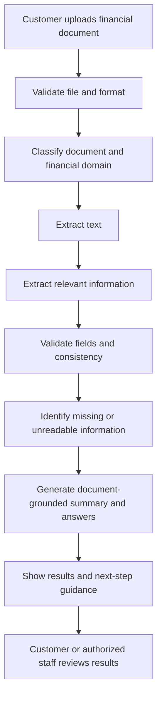

# AI-Powered Financial Journeys

**Track:** Track 2 – AI-Powered Financial Journeys  
**Theme:** Make Insurance, Lending and Fintech simpler, faster and more human.

> **Document purpose:** This file describes a proposed project scope and a practical Quality Assurance (QA) requirements baseline for development and testing. It is derived from the problem statement; it is not an official organizer-issued specification. Confirm final scope and acceptance criteria with the project team or organizers.

---

## 1. Project Overview

The project aims to develop an AI-powered system that improves customer-facing journeys across **Insurance, Lending and Fintech**. The system should help customers and service teams understand financial documents, extract relevant information, identify missing or inconsistent details, and receive clear guidance about the next steps.

The central idea is to reduce avoidable manual work and confusion while making financial services easier to understand and navigate.

### 1.1 Project Objective

Build an AI-powered financial assistant that can:

- Accept supported financial documents from customers.
- Identify the type and financial domain of each document.
- Extract relevant information from the document.
- Validate extracted information and flag missing or inconsistent fields.
- Summarize complex financial information in simple language.
- Answer customer questions using information supported by the supplied documents.
- Guide customers through relevant next steps.

### 1.2 The Three Project Goals

| Goal | Meaning | Example |
|---|---|---|
| **Simpler** | Reduce confusing terminology, lengthy manual steps and unnecessary complexity. | Explain an insurance policy's coverage and exclusions in plain language. |
| **Faster** | Automate suitable repetitive tasks and reduce manual document review. | Extract applicant details from a loan application and identify missing fields. |
| **More human** | Give customers understandable, relevant and supportive guidance. | Explain why a document needs correction and tell the customer what information is required. |

---

## 2. Scope of the Solution

The system is intended to support three financial-service areas.

### 2.1 Insurance

Potential document and customer journeys:

- Insurance policy documents and policy schedules.
- Health or other insurance claim forms.
- Claim-related supporting documents.
- Premium statements and payment records.

Potential system capabilities:

- Extract policyholder, insured-member and policy details.
- Identify coverage, exclusions, waiting periods and important policy conditions where stated in the document.
- Extract claim and hospitalisation details from relevant claim documents.
- Identify required fields or supporting documents that appear to be missing.
- Summarize policy or claim information in plain language.
- Explain the next steps described in the supplied policy or claim instructions.

### 2.2 Lending

Potential document and customer journeys:

- Personal-loan and home-loan application forms.
- Salary slips and income proofs.
- Bank statements submitted as supporting documents.
- Loan agreements, key fact statements and repayment schedules.

Potential system capabilities:

- Extract applicant, employment, income and loan-request details.
- Extract relevant entries from supporting financial documents.
- Identify missing fields and apparent inconsistencies between supplied documents.
- Summarize loan terms, repayment conditions, charges and other clauses when stated in the source.
- Explain what additional information may be required to complete an application.

**Important limitation:** Document extraction and preliminary checks must not be represented as a formal credit decision. Loan eligibility or approval should only be calculated if the project has an approved, documented rule set and the result is clearly identified as an estimate or decision from the authorized process.

### 2.3 Fintech

Potential document and customer journeys:

- Bank statements and transaction histories.
- UPI and other digital-payment records.
- Credit-card statements.
- Payment-dispute or complaint forms.

Potential system capabilities:

- Extract transaction dates, descriptions, reference identifiers, debits, credits and balances when available.
- Categorize transactions using clear and testable rules or an appropriately validated model.
- Identify possible duplicate, unusual or inconsistent entries for review.
- Help customers understand a transaction or payment record.
- Capture information needed to raise or track a payment dispute.

**Important limitation:** A flagged transaction is not proof of fraud. The system should describe it as a possible anomaly and request review. It must not claim that a payment has been reversed or a complaint resolved unless a trusted service confirms that result.

---

## 3. Proposed End-to-End Workflow

1. **Customer uploads a document** in a supported format.
2. **File and format validation** checks whether the file can be processed safely.
3. **Document classification** identifies the likely document type and domain: Insurance, Lending or Fintech.
4. **Text extraction** reads text from the document. OCR may be used for scanned documents if supported.
5. **Information extraction** identifies relevant fields and values.
6. **Validation** checks required fields, formats, consistency and readability.
7. **Missing-information detection** reports fields or supporting documents that could not be found.
8. **AI understanding** uses the extracted content to answer questions or explain the document.
9. **Summary and next-step guidance** presents results in plain language.
10. **Customer review** allows the customer or an authorized staff member to correct or confirm extracted details.

### 3.1 Workflow Diagram



---

## 4. Functional Requirements

The following are proposed functional requirements. They should be adjusted to match the features actually implemented.

| Requirement ID | Requirement | Expected behaviour |
|---|---|---|
| **FR-01** | Document Upload | Accept files in the formats explicitly supported by the application. |
| **FR-02** | File Validation | Check file type, size and processability; show a useful error for unsupported or invalid files. |
| **FR-03** | Document Classification | Identify the likely document category and financial domain. |
| **FR-04** | Information Extraction | Extract relevant fields and values from supported documents. |
| **FR-05** | Data Validation | Check extracted values for required fields, valid formats and apparent inconsistencies. |
| **FR-06** | Missing Information Detection | Identify required details that are absent, unreadable or not confidently extracted. |
| **FR-07** | Document Summarization | Explain the document's important information in simple language without changing its meaning. |
| **FR-08** | Question Answering | Answer customer questions using the supplied document or approved source material. |
| **FR-09** | Customer Guidance | Explain the next steps or additional information required for the relevant journey. |
| **FR-10** | Result Presentation | Display the document category, extracted fields, validation status, missing information and summary. |
| **FR-11** | Error Handling | Handle unreadable, corrupted, empty or unsupported files without crashing. |
| **FR-12** | Source Traceability | Where possible, show the page, section or text evidence supporting extracted values and answers. |

---

## 5. QA Testing Requirements

QA testing should verify that the system works correctly with valid, incomplete, ambiguous, scanned, unsupported and inconsistent documents.

### 5.1 Core Test Scenarios

| Test Case ID | Test scenario | Expected result |
|---|---|---|
| **TC-01** | Upload a valid PDF in a supported category. | File uploads and enters the processing workflow successfully. |
| **TC-02** | Upload an unsupported file type. | System rejects the file and displays the supported formats. |
| **TC-03** | Upload a corrupted or password-protected file that cannot be read. | System reports that the document could not be processed and does not crash. |
| **TC-04** | Upload an insurance policy. | System identifies the likely insurance document type and extracts supported policy details. |
| **TC-05** | Upload an insurance claim form. | System extracts available claim details and identifies missing or unreadable fields. |
| **TC-06** | Ask a question about policy coverage. | Answer is supported by the policy text; uncertain or absent information is clearly identified. |
| **TC-07** | Upload a loan application form. | System identifies the loan document and extracts available applicant and loan details. |
| **TC-08** | Upload a salary slip or income proof. | System extracts available income and employment fields and preserves their stated values. |
| **TC-09** | Supply two documents with conflicting values. | System flags the conflict and does not silently choose or alter a value. |
| **TC-10** | Upload an incomplete application. | System lists required fields that are missing or unreadable. |
| **TC-11** | Upload a bank statement. | System extracts available transaction data and preserves dates, signs and amounts. |
| **TC-12** | Upload a payment-dispute form. | System extracts the available transaction and complaint details. |
| **TC-13** | Upload a scanned or low-quality document. | System extracts readable content where possible and flags uncertain or unreadable values. |
| **TC-14** | Upload an unrelated document. | System identifies it as unsupported or outside the intended financial-document scope. |
| **TC-15** | Upload the same document more than once. | System follows the defined duplicate-handling behaviour and does not unintentionally duplicate processing or records. |
| **TC-16** | Ask a question whose answer is not in the document. | System says that the information is not available in the supplied source rather than inventing an answer. |
| **TC-17** | Request a summary of a long document. | Summary retains important conditions and does not contradict the original document. |
| **TC-18** | Process a document with sensitive information. | Access and display follow the application's privacy and security controls. |

### 5.2 Extraction Accuracy Checks

For each test document, compare extracted values against the original source. Check at least:

- Names and identifiers, where present in the test material.
- Dates and date formats.
- Monetary values and currency.
- Debit and credit signs.
- Account, policy, application or transaction references, where present.
- Tables and multi-line fields.
- Missing, blank, crossed-out or unreadable fields.

The test record should note the source page or location, expected value, actual extracted value and whether the result passed.

### 5.3 Suggested QA Result Labels

Use labels consistently in the application and test reports:

- **Pass:** Result matches the source and expected behaviour.
- **Needs Review:** Information is incomplete, ambiguous or uncertain and requires human confirmation.
- **Fail:** The system produces an incorrect result, misses a required error or does not follow the expected behaviour.
- **Unable to Process:** The input cannot be read or is not supported.

Avoid using a single “Valid” status to imply that a financial application, insurance claim or transaction has been formally approved.

---

## 6. Non-Functional Requirements

| Requirement | Description |
|---|---|
| **Accuracy** | Extracted values and generated answers should match the source material. |
| **Performance** | Processing should complete within a reasonable, measured time for the supported file sizes. |
| **Security** | Documents and customer financial information must be protected against unauthorized access. |
| **Privacy** | Collect, display, retain and share only the information needed for the stated purpose. |
| **Reliability** | Processing errors should be handled without crashing or corrupting other results. |
| **Usability** | Instructions, errors, summaries and next steps should be understandable to non-expert customers. |
| **Traceability** | Important extracted values and answers should be linked to source evidence where technically possible. |
| **Scalability** | The design should support increased document volume and concurrent users as required. |
| **Accessibility** | The interface should be usable by customers with different levels of digital and financial literacy. |

---

## 7. Test Data and Document Requirements

Use genuine, publicly available documents and datasets from official or otherwise trustworthy sources wherever possible. Keep a record of each document's source, download date, version and whether it contains blank form fields, illustrative examples or published aggregate data.

### 7.1 Insurance Test Documents

- Insurance policy wordings.
- Policy schedules and benefit summaries.
- Insurance claim forms.
- Claim intimation forms.
- Publicly available claim checklists and supporting-document requirements.
- Premium statements or sample statements published for testing or illustration.

### 7.2 Lending Test Documents

- Personal-loan application forms.
- Home-loan application forms.
- Loan agreements.
- Key Fact Statements (KFS).
- Repayment schedules.
- Publicly available sample salary slips or income-proof templates.
- Publicly available sample bank statements, where available.

### 7.3 Fintech Test Documents and Data

- Bank-statement samples.
- Public UPI or digital-payment transaction datasets.
- Payment dispute and complaint forms.
- Credit-card statement samples.
- Official payment-system guidance and complaint-resolution documents.
- Published aggregate payment statistics.

### 7.4 Test Data Integrity Rules

1. Do not invent personal or financial records and describe them as real customer data.
2. Distinguish a blank official form from a completed customer record.
3. Distinguish illustrative or synthetic examples from actual observed transactions.
4. Do not assume that a public policy document contains customer-specific claim data.
5. Record the original source and keep the source document unchanged for comparison.
6. Use appropriately authorized, consented and protected data for any non-public customer records.
7. Mask or remove personal identifiers when they are not necessary for a test.

### 7.5 Suggested Test Data Folder Structure

```text
project/
├── README.md
├── project.md
├── test_data/
│   ├── insurance/
│   │   ├── policy_wordings/
│   │   ├── claim_forms/
│   │   └── claim_guidelines/
│   ├── lending/
│   │   ├── loan_applications/
│   │   ├── loan_agreements/
│   │   ├── key_fact_statements/
│   │   └── repayment_schedules/
│   ├── fintech/
│   │   ├── bank_statements/
│   │   ├── payment_disputes/
│   │   └── transaction_datasets/
│   └── source_register.csv
└── test_results/
    ├── test_cases.csv
    └── execution_results.csv
```

Suggested columns for `source_register.csv`:

```text
file_name,domain,document_type,source_organization,source_url,download_date,document_version,data_type,notes
```

Suggested columns for `test_cases.csv`:

```text
test_case_id,domain,input_file,test_scenario,expected_result,actual_result,status,source_page,comments
```

---

## 8. Expected System Output

For each processed document, the application should present a structured result. The exact fields depend on the document type.

### 8.1 Common Result Sections

1. **Document Type:** The document category identified by the system.
2. **Financial Domain:** Insurance, Lending or Fintech.
3. **Extracted Details:** Fields and values found in the document.
4. **Validation Status:** Pass, Needs Review, Fail or Unable to Process, based on the checks performed.
5. **Missing or Unreadable Information:** Fields that were not found or could not be read confidently.
6. **AI Summary:** A plain-language explanation of the important content.
7. **Source Evidence:** Page, section or text references supporting important results, where available.
8. **Recommended Next Steps:** Practical actions based on the source document and defined workflow.

### 8.2 Example Output Structure

The following is a proposed structure, not actual customer data:

```json
{
  "document_type": "insurance_policy",
  "financial_domain": "insurance",
  "processing_status": "completed",
  "extracted_details": {},
  "validation_status": "needs_review",
  "missing_or_unreadable_information": [],
  "summary": "Plain-language summary grounded in the source document.",
  "source_evidence": [],
  "recommended_next_steps": []
}
```

The system must not fill unknown fields with guesses. Use an explicit null, “not found” or “unable to read” value according to the application's data contract.

---

## 9. Acceptance Criteria

The first usable version of the project can be considered ready for demonstration when:

- Users can upload files in the formats listed as supported by the application.
- Unsupported and unreadable files produce clear error messages.
- The system can classify the document types included in the agreed test set.
- The system extracts the agreed fields from each supported document type.
- Extracted values can be checked against the original source.
- Missing, unreadable and conflicting information is flagged rather than silently guessed.
- Summaries and question answers are grounded in the supplied document or approved sources.
- The application gives clear next-step guidance without claiming an unverified approval, rejection, payment reversal or claim settlement.
- Sensitive information is handled according to the project's privacy and security requirements.
- QA test results, known limitations and unsupported document types are documented.

Final numeric targets for extraction accuracy, response time, supported file size and concurrent users should be agreed by the team and measured during testing; they are not assumed in this baseline.

---

## 10. Safety, Trust and Human Review

Financial documents can contain sensitive and consequential information. The system should follow these principles:

- **No fabricated facts:** Never invent a name, income, balance, policy term, transaction, claim detail or loan condition.
- **Source-grounded answers:** Explain which document or approved source supports an answer.
- **Clear uncertainty:** Flag low-confidence, missing or conflicting information.
- **Human review:** Require customer or authorized staff confirmation for consequential corrections and decisions.
- **No unsupported decisions:** Do not claim loan approval, claim approval, fraud confirmation or dispute resolution without an authorized and verified decision source.
- **Data minimization:** Avoid collecting or displaying sensitive details that are not needed for the task.
- **Secure handling:** Apply appropriate access controls, encryption, retention limits and secure deletion practices.

---

## 11. Project Summary

The project proposes an AI-powered financial assistant for Insurance, Lending and Fintech. It processes customer-provided financial documents, extracts and validates information, identifies missing or inconsistent details, summarizes complex content and provides understandable next-step guidance.

**In one sentence:** Build an AI-powered assistant that reads, understands, verifies and explains insurance, lending and fintech documents so customers can complete important financial journeys with less confusion, less manual effort and greater confidence.

---

## 12. Open Decisions for the Development Team

Before implementation and final QA sign-off, agree on:

- Exact file formats and maximum file sizes to support.
- Exact document types and fields to extract in the first release.
- Whether scanned documents and OCR are in scope.
- The languages to support.
- The confidence thresholds for extraction and when to request human review.
- Which rules define required fields and document completeness for each journey.
- Whether transaction categorization or anomaly detection is in scope, and how it will be evaluated.
- Data storage, retention, deletion and access-control policies.
- Target extraction accuracy, processing time and system-load requirements.
- Which outputs are informational only and which, if any, are connected to an authorized decision process.
